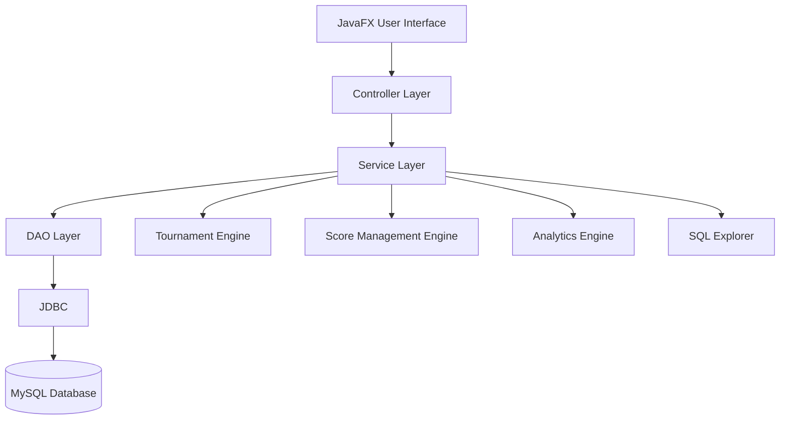

# 🏆 ARENA-X
### Intelligent Sports Tournament Registration, Score Management & SQL Visualization System

**ARENA-X** is a Java-based sports tournament management application designed to simplify tournament organization, team registration, match scheduling, score management, and performance analytics.

The application combines sports management functionality with an interactive SQL Explorer that helps users understand database operations, relationships, and query execution.

Built using Java, JavaFX, and MySQL, ARENA-X provides a modern desktop interface with a reliable relational database backend.

---

🌐 **Live Demo:** [Check out ARENA-X Live](https://arena-x-henna.vercel.app/)

## 🚀 Project Overview

Managing sports tournaments manually can be time-consuming and error-prone.

Organizers often face challenges such as:

- Managing team and player registrations
- Creating tournament fixtures
- Scheduling matches
- Recording scores
- Maintaining tournament standings
- Calculating player statistics
- Managing database records
- Tracking tournament performance

ARENA-X aims to solve these challenges through a centralized sports management platform.

The system automates tournament workflows, maintains structured database records, and provides an interactive interface for managing sports competitions.

---

## ✨ Key Features

### 🏟️ Tournament Management
- Create and manage tournaments
- Configure tournament formats
- Manage tournament schedules
- Track tournament status
- Register participating teams
- Manage tournament venues

### 👥 Team & Player Management
- Create and manage teams
- Register players
- Assign team captains
- Maintain player profiles
- Track player statistics
- Manage team memberships

### 📅 Automated Fixture Generation
- Generate knockout fixtures
- Generate round-robin fixtures
- Generate league schedules
- Handle odd numbers of teams
- Prevent duplicate fixtures
- Automatically advance knockout winners

### ⚡ Match & Score Management
- Manage match schedules
- Record match scores
- Update match results
- Determine match winners
- Maintain score history
- Track match status

### 📊 Leaderboards & Analytics
- Calculate team rankings
- Track wins and losses
- Calculate tournament points
- Display player statistics
- Compare team performances
- Visualize tournament analytics

### 🗄️ Interactive SQL Explorer

A dedicated educational module designed to demonstrate database operations.

Features include:

- Database schema exploration
- Table and column inspection
- Primary key and foreign key visualization
- SQL query execution
- SQL query history
- CRUD demonstrations
- SQL JOIN visualization
- Transaction demonstrations
- COMMIT and ROLLBACK
- MySQL EXPLAIN query analysis

The SQL Explorer helps users understand how the application interacts with its underlying relational database.

---

## 🛠️ Technology Stack

| Technology | Purpose |
|---|---|
| Java 21 | Application programming language |
| JavaFX | Desktop user interface |
| JavaFX CSS | UI styling |
| MySQL 8+ | Relational database |
| MySQL Workbench | Database administration |
| JDBC | Java-MySQL connectivity |
| MySQL Connector/J | JDBC driver |
| Maven | Dependency management |
| JavaFX Charts | Data visualization |
| BCrypt | Password hashing |
| JUnit | Application testing |

---

## 🏗️ System Architecture

ARENA-X follows a layered architecture to maintain separation of concerns.



### Architecture Components

- **UI Layer:** Provides the JavaFX desktop interface.
- **Controller Layer:** Handles user interactions.
- **Service Layer:** Implements application business logic.
- **DAO Layer:** Manages database operations.
- **JDBC Layer:** Connects Java to MySQL.
- **Database Layer:** Stores application data.
- **Tournament Engine:** Generates fixtures and manages tournament progression.
- **Analytics Engine:** Calculates statistics and rankings.
- **SQL Explorer:** Provides database exploration and SQL learning functionality.

---

## 🗄️ Database Design

The application uses a relational MySQL database named:

```sql
arena_x_db
```

### Main Database Tables

| Table | Description |
|---|---|
| users | Stores user accounts and roles |
| players | Stores player profiles |
| teams | Stores team information |
| team_members | Maps players to teams |
| tournaments | Stores tournament details |
| registrations | Stores tournament registrations |
| matches | Stores tournament fixtures |
| match_scores | Stores match scores and results |
| player_statistics | Stores player performance |
| venues | Stores venue information |
| audit_logs | Stores activity and score-change history |

The database uses primary keys, foreign keys, constraints, and relational integrity to maintain consistency.

---

## 💻 Installation & Setup

### Prerequisites

Install the following software:

- Java Development Kit (JDK) 21
- IntelliJ IDEA or Eclipse
- MySQL Server 8+
- MySQL Workbench
- Maven

Verify Java installation:

```bash
java -version
```

Verify Maven installation:

```bash
mvn -version
```

### Step 1: Clone the Repository

```bash
git clone <YOUR_GITHUB_REPOSITORY_URL>
```

Navigate to the project directory:

```bash
cd ARENA-X
```

### Step 2: Create the MySQL Database

Open MySQL Workbench and connect to your MySQL Server.

Create the database:

```sql
CREATE DATABASE arena_x_db;
```

Select the database:

```sql
USE arena_x_db;
```

Import the database schema provided in the project.

Example:

```text
database/schema.sql
```

Import the sample data:

```text
database/seed_data.sql
```

### Step 3: Configure Database Connectivity

Configure the MySQL connection settings using the application's configuration file or environment variables.

Example:

```properties
DB_HOST=localhost
DB_PORT=3306
DB_NAME=arena_x_db
DB_USER=your_mysql_username
DB_PASSWORD=your_mysql_password
```

**Important:** Never commit actual database passwords or API keys to GitHub.

### Step 4: Build the Application

Run:

```bash
mvn clean install
```

### Step 5: Run the Application

Run:

```bash
mvn javafx:run
```

Alternatively, open the Maven project in IntelliJ IDEA or Eclipse and run the main JavaFX application class.

---

## 📂 Project Structure

The project follows a modular Java architecture.

```text
ARENA-X/
│
├── src/
│   ├── main/
│   │   ├── java/
│   │   │   └── com/arenax/
│   │   │       ├── app/
│   │   │       ├── config/
│   │   │       ├── controller/
│   │   │       ├── model/
│   │   │       ├── dao/
│   │   │       ├── service/
│   │   │       ├── database/
│   │   │       ├── algorithm/
│   │   │       ├── sql/
│   │   │       └── util/
│   │   │
│   │   └── resources/
│   │       ├── css/
│   │       ├── fxml/
│   │       └── images/
│   │
│   └── test/
│       └── java/
│
├── database/
│   ├── schema.sql
│   ├── seed_data.sql
│   └── reset_database.sql
│
├── pom.xml
├── README.md
└── .gitignore
```

*The structure may vary slightly depending on the final implementation.*

---

## 📸 Application Screenshots

Add screenshots of the application here.

### Dashboard


### Tournament Management


### SQL Explorer


### Database Schema


---

## 🔐 Security

ARENA-X follows basic application security practices:

- Password hashing using BCrypt
- Prepared statements for database queries
- Input validation
- Role-based access control
- Database constraints
- Transaction management
- Audit logging
- Secure configuration management

Database credentials and external API keys must not be committed to the repository.

---

## 🎯 Future Enhancements

Potential future improvements include:

- Real-time sports data integration
- Live score updates
- QR-based player check-in
- Advanced scheduling optimization
- AI-powered performance insights
- Mobile application support
- Cloud database integration
- Notification system
- Advanced sports analytics

These enhancements depend on implementation and available external services.

---

## 🎓 Academic Relevance

ARENA-X demonstrates practical concepts from:

- Object-Oriented Programming
- Java Application Development
- Database Management Systems
- Relational Database Design
- JDBC Connectivity
- SQL Queries
- SQL Joins
- Database Transactions
- ACID Properties
- Data Integrity
- Software Architecture
- Data Visualization
- Algorithm Design

The SQL Explorer provides an interactive environment for demonstrating database concepts during academic evaluations and DBMS viva sessions.

---

## 👨‍💻 Project Information

**Project Name:** ARENA-X

**Project Type:** Sports Tournament Management System

**Programming Language:** Java

**Frontend:** JavaFX

**Database:** MySQL

**Database Administration:** MySQL Workbench

**Connectivity:** JDBC

**Purpose:** Academic Software Engineering and DBMS Project

---

## 📜 License

This project is developed for academic and educational purposes.

A license may be added depending on the intended distribution and usage.

---

### ARENA-X

**Manage Tournaments. Track Performance. Understand Data.**
